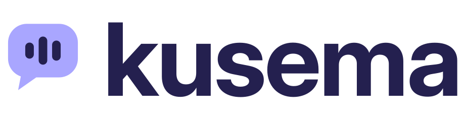

<p align="center">
  
</p>

<p align="center"><strong>Talk to AI. Keep your voice.</strong><br>
Private dictation and a spoken AI assistant for Windows. Your voice never leaves your computer.</p>

---

_Kusema_ is Swahili for "to speak."

Most voice AI sends a recording of your voice to someone else's servers. Kusema doesn't. Speech is turned into text **on your own computer**. Only the text goes to the AI you choose (or nowhere at all, if you use a local model). Replies are spoken back by a voice that also runs on your computer.

## What it does

| Hotkey (Windows)         | What happens                                                                                                                                                                                                                             |
| ------------------------ | ---------------------------------------------------------------------------------------------------------------------------------------------------------------------------------------------------------------------------------------- |
| **Ctrl+Space**           | **Dictate.** Speak, and your words are typed wherever your cursor is: email, Word, a browser, anything.                                                                                                                                  |
| **Ctrl+Shift+Space**     | **Dictate with AI cleanup.** Same as above, with the text tidied up by AI first. Available once Post Processing is turned on (see below).                                                                                                |
| **Ctrl+Alt+Space**       | **Ask Kusema.** Ask a question out loud and hear the answer. Follow-up questions remember the conversation.                                                                                                                              |
| **Ctrl+Alt+Shift+Space** | **Ask about my screen.** Captures the window you're looking at and lets you ask about it ("what do you think of this document?"). You see a preview first, and **nothing is sent until you press Send (or Enter)**. Press Esc to cancel. |
| **Esc**                  | Cancel recording, cancel a screenshot, or stop Kusema talking.                                                                                                                                                                           |

Hold the hotkey while you speak and release when you're done, or tap it once to start and again to stop. To allow only one of the two, change **Shortcut Behavior** on the **General** page.

## Privacy, in plain terms

- **Your voice stays on your computer.** Speech recognition runs locally (Parakeet or Whisper models). No audio is uploaded, ever.
- **Only text is sent, and only where you choose.** Ask Kusema sends the _text_ of your question to the AI provider you configure: Anthropic (Claude), OpenAI, OpenRouter, Groq and others.
- **Or keep everything local.** Point Kusema at a model running on your own machine (for example through [Ollama](https://ollama.com)) and nothing leaves the computer at all.
- **Screenshots are opt-in, every time.** "Ask about my screen" captures only the active window, shows you exactly what will be sent and where, and waits for you to confirm (you can turn the confirmation off, but it's on unless you do). Screenshots are kept in memory only, never saved to disk or history. You can also send screen questions to a local model while normal questions go to the cloud.
- **Spoken replies are generated locally** with Kokoro voices or your built-in Windows voices.
- **Your API key is stored in Windows Credential Manager**, not in a plain-text settings file.
- **Open source.** Every claim above can be checked in this repository.

Check your AI provider's own terms for how they handle the text you send them.

## Getting started

1. Download the latest **`Kusema_x.y.z_x64-setup.exe`** from [Releases](https://github.com/neulinc/kusema/releases/latest) and run it.
   - Kusema isn't code-signed yet, so Windows may show **"Windows protected your PC."** Click **More info → Run anyway**.
2. The first time Kusema opens, a short setup walks you through it: pick the languages you'll speak, allow microphone access, and choose a speech model (the recommended one is the best balance of speed and accuracy for your languages; it downloads while you finish setup). Then try dictation right there.
3. Later, try it anywhere: open Notepad, hold **Ctrl+Space**, speak, release.
4. To use **Ask Kusema**:
   - On the **Assistant** page, click **Turn on Post Processing** (or turn it on under **Advanced**), then **Open Post Process settings**: choose a provider (e.g. Anthropic), paste your API key and pick a model.
   - On the **Assistant** page, download the **Kokoro** voices for natural speech (about 200 MB, one time) and choose a voice.
   - Hold **Ctrl+Alt+Space** and ask a question.
5. To ask about your screen, pick a model that can see images (Claude models can), then hold **Ctrl+Alt+Shift+Space** in the window you want to ask about.

Kusema updates itself: when a new version is released, the app offers to install it.

## Status

Kusema is **early software** (version 0.x), currently developed and tested on **Windows 10/11 (x64)**. macOS and Linux builds may compile but aren't supported yet.

**Coming next:** safe voice commands for Windows settings (dark mode, volume, wallpaper and more) and an optional "Hey Kusema" wake word.

## Building from source

See [BUILD.md](BUILD.md) for prerequisites (Rust, Bun, Visual Studio C++ Build Tools, CMake, Vulkan SDK), then:

```
bun install
bun run tauri dev
```

Release process: [docs/releasing.md](docs/releasing.md).

## Credits

Kusema is built on **[Handy](https://github.com/cjpais/Handy)** by CJ Pais, a free, open-source, offline speech-to-text app, used under the MIT License. Handy provides Kusema's dictation engine, audio pipeline and much of its interface. Thank you to CJ and Handy's contributors.

Kusema is an independent project and is not affiliated with or endorsed by Handy.

Also built with: [Tauri](https://tauri.app), [Parakeet](https://huggingface.co/nvidia) and [Whisper](https://github.com/openai/whisper) speech models, [Silero VAD](https://github.com/snakers4/silero-vad), [Kokoro](https://huggingface.co/hexgrad/Kokoro-82M) text-to-speech, [misaki](https://github.com/hexgrad/misaki) pronunciation data, and [ONNX Runtime](https://onnxruntime.ai).

## License

MIT, see [LICENSE](LICENSE). Kusema's name, logo and artwork are © Neulinc LLC and are not covered by the open-source license.

---

<p align="center">Made by <a href="https://github.com/neulinc">Neulinc</a>: Smarter Systems for Small Giants.</p>
