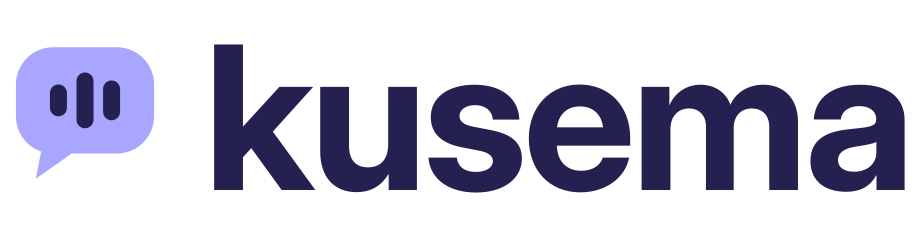

<p align="center">
  
</p>

<p align="center"><strong>Talk to AI. Keep your voice.</strong><br>
Private dictation and a spoken AI assistant for Windows. Your voice never leaves your computer.</p>

---

_Kusema_ is Swahili for "to speak."

Most voice AI sends a recording of your voice to someone else's servers. Kusema doesn't. Speech is turned into text **on your own computer**. Only the text goes to the AI you choose (or nowhere at all, if you use a local model). Replies are spoken back by a voice that also runs on your computer.

## What it does

| Hotkey (Windows)             | What happens                                                                                                                                                                                                                                                                                |
| ---------------------------- | ------------------------------------------------------------------------------------------------------------------------------------------------------------------------------------------------------------------------------------------------------------------------------------------- |
| **Ctrl+Space**               | **Dictate.** Speak, and your words are typed wherever your cursor is: email, Word, a browser, anything.                                                                                                                                                                                     |
| **Ctrl+Shift+Space**         | **Dictate with AI cleanup.** Same as above, with the text tidied up by AI first. Available once Post Processing is turned on (see below).                                                                                                                                                   |
| **Ctrl+Alt+Space**           | **Ask Kusema.** Ask a question out loud and hear the answer. Follow-up questions remember the conversation.                                                                                                                                                                                 |
| **Ctrl+Alt+Shift+Space**     | **Ask about my screen.** Captures the window you're looking at and lets you ask about it ("what do you think of this document?"). You see a preview first, and **nothing is sent until you press Send (or Enter)**. Press Esc to cancel.                                                    |
| **Ctrl+Alt+Shift+Enter**     | **Edit by voice.** Select text in any app and say how to change it ("make this more formal", "shorten to two sentences", "translate to Spanish"). You see the new text first; Enter replaces it, and Ctrl+Z in the app undoes it. Or say a command like "select last sentence" (see below). |
| **Ctrl+Alt+Shift+Backspace** | **Type to Kusema.** Opens a small box over your window to type a question instead of saying it. The answer appears in the box; Esc closes it.                                                                                                                                               |
| **Esc**                      | Cancel recording, cancel a screenshot, or stop Kusema talking.                                                                                                                                                                                                                              |

Hold the hotkey while you speak and release when you're done, or tap it once to start and again to stop. To allow only one of the two, change **Shortcut Behavior** on the **General** page.

### Voice editing commands

Hold **Ctrl+Alt+Shift+Enter** and say one of these on its own. They run on your computer and send nothing anywhere. The ones marked \* also work during continuous dictation, said alone.

| Say                                                                              | What it does                                                                             |
| -------------------------------------------------------------------------------- | ---------------------------------------------------------------------------------------- |
| "select last word" \*, "select last three words" \*                              | Selects words before the cursor, with their punctuation                                  |
| "select line" \*, "select all" \*                                                | Selects the line, or everything                                                          |
| "select last sentence" \*, "select last paragraph" \*                            | Selects the sentence or paragraph before the cursor                                      |
| "select" followed by words, e.g. "select the motion"                             | Selects those words: the nearest before the cursor, else the first after                 |
| "go to start of line" \*, "go to end of line" \*                                 | Moves the cursor                                                                         |
| "go to start of document" \*, "go to end of document" \*                         | Moves the cursor                                                                         |
| "new paragraph" \*, "new line" \*                                                | Starts a new paragraph or line                                                           |
| "delete that" \*, "cut that" \*, "copy that" \*, "paste that" \*, "undo that" \* | Delete, cut or copy the selection; paste; undo (Ctrl+Z). Delete and cut need a selection |

Anything else you say with this hotkey is an instruction for your AI provider, applied to the selection. With nothing selected, Kusema uses the text it just typed in that window, if it can find it exactly; otherwise it asks you to select the text first. The selection is sent as text to edit, never as instructions, so a document can't take over the request. In Privileged mode only a model on your own computer is used, and every edit is listed in the privacy ledger (sizes only).

The commands are in English. "Select last sentence", "select last paragraph" and "select …" need an app that lets Kusema read its text through Windows UI Automation: Word, Outlook, Notepad and text boxes in Chrome or Edge do. The other commands use standard keys and work almost everywhere. Some apps, such as ONLYOFFICE, LibreOffice and Google Docs, don't show their text that way: there, select the text with the mouse or keyboard first, and Kusema copies it (putting your clipboard back afterwards).

During continuous dictation, start a sentence with **"Kusema,"** to edit instead of typing: "Kusema, make this more formal". Without that word, everything is typed as you say it. The word can be changed under **General → Voice Editing**, where **Use Right Ctrl** also sets a one-key shortcut for editing. The same list is in the app under **General → Voice Editing → What can I say?**

### Vocabulary and corrections

Kusema writes legal terms and citations correctly out of the box ("habeas corpus", "voir dire", "42 U.S.C.", "123 F.3d 456", "Smith v. Jones"), with an optional medical pack. Add your own names and terms on the **Vocabulary** page, or import a word list from Dragon. When Kusema mishears a word, say **"correct that"** (or use **Correct Last Dictation** in the tray, or **Correct** in History), fix it, and Kusema learns it for next time. Learning stays on your computer.

### Typed questions, answers in your document, tutor style

- **Type instead of talking:** press **Ctrl+Alt+Shift+Backspace**, or use the box at the bottom of the Assistant's Conversation tab. It's the same conversation as spoken questions. Typed answers aren't read aloud unless you turn that on.
- **Answers straight into your document:** end a question with "…and type it" or "…put it in the document" ("draft a reply declining this meeting and type it"), or set **Answer goes to** to type every answer. Kusema types only into the window you asked from; if you've clicked elsewhere, it waits for you to come back. One Ctrl+Z takes it out again. Every answer also has **Insert into document**.
- **Tutor style:** turn it on, or say "step by step" in a question, and Kusema explains one step at a time and checks you've followed, instead of handing over homework answers. Follow your school's or exam's rules on AI use.
- **Styles per app:** AI cleanup, AI voice edits and typed answers follow the program they go into: email format in Outlook, formal in Word and ONLYOFFICE, short and casual in Teams and Slack, neutral elsewhere. Kusema looks only at the program's name, on your computer. Edit the styles in plain words and add programs on the Assistant page.

## Privacy, in plain terms

- **Your voice stays on your computer.** Speech recognition runs locally (Parakeet or Whisper models). No audio is uploaded, ever.
- **Only text is sent, and only where you choose.** Ask Kusema sends the _text_ of your question to the AI provider you configure: Anthropic (Claude), OpenAI, OpenRouter, Groq and others.
- **Or keep everything local.** Point Kusema at a model running on your own machine (for example through [Ollama](https://ollama.com)) and nothing leaves the computer at all.
- **Screenshots are opt-in, every time.** "Ask about my screen" captures only the active window, shows you exactly what will be sent and where, and waits for you to confirm (you can turn the confirmation off, but it's on unless you do). Screenshots are kept in memory only, never saved to disk or history. You can also send screen questions to a local model while normal questions go to the cloud.
- **Spoken replies are generated locally** with Kokoro voices or your built-in Windows voices.
- **Your API key is stored in Windows Credential Manager**, not in a plain-text settings file.
- **Open source.** Every claim above can be checked in this repository.

Check your AI provider's own terms for how they handle the text you send them.

## Getting started

1. Download the latest **`Kusema_x.y.z_x64-setup.exe`** from [Releases](https://github.com/neulinc/kusema/releases/latest) and run it.
   - Kusema isn't code-signed yet, so Windows may show **"Windows protected your PC."** Click **More info → Run anyway**.
2. The first time Kusema opens, a short setup walks you through it: pick the languages you'll speak, allow microphone access, and choose a speech model (the recommended one is the best balance of speed and accuracy for your languages; it downloads while you finish setup). Then try dictation right there.
3. Later, try it anywhere: open Notepad, hold **Ctrl+Space**, speak, release.
4. To use **Ask Kusema**:
   - On the **Assistant** page, click **Turn on Post Processing** (or turn it on under **Advanced**), then **Open Post Process settings**: choose a provider (e.g. Anthropic), paste your API key and pick a model.
   - On the **Assistant** page, download the **Kokoro** voices for natural speech (about 200 MB, one time) and choose a voice.
   - Hold **Ctrl+Alt+Space** and ask a question.
5. To ask about your screen, pick a model that can see images (Claude models can), then hold **Ctrl+Alt+Shift+Space** in the window you want to ask about.

Kusema updates itself: when a new version is released, the app offers to install it.

## Where the speech models come from

Kusema downloads its speech models from Hugging Face the first time you pick one, checks each file's size and SHA-256, then runs them on your computer. No account is needed. Every download appears on the **Privacy** page.

If your office blocks downloads, you can install a model by hand: download its file on another computer and put it in Kusema's `models` folder (`%APPDATA%\com.neulinc.kusema\models`), then restart Kusema. Kusema's copies, with their licenses and hashes, are at [huggingface.co/kusema](https://huggingface.co/kusema):

- [Parakeet Unified English](https://huggingface.co/kusema/parakeet-unified-en-0.6b-gguf) (the default)
- [Parakeet TDT v3](https://huggingface.co/kusema/parakeet-tdt-0.6b-v3-gguf), [Nemotron 3.5 Streaming](https://huggingface.co/kusema/nemotron-3.5-asr-streaming-0.6b-gguf) and [Canary 180M Flash](https://huggingface.co/kusema/canary-180m-flash-gguf)
- [Whisper in GGML format](https://huggingface.co/kusema/whisper-ggml) and [Breeze ASR](https://huggingface.co/kusema/breeze-asr-ggml) (older formats)

## Status

Kusema is **early software** (version 0.x), currently developed and tested on **Windows 10/11 (x64)**. macOS and Linux builds may compile but aren't supported yet.

**Coming next:** safe voice commands for Windows settings (dark mode, volume, wallpaper and more) and an optional "Hey Kusema" wake word.

## Troubleshooting

### Shortcuts stopped working on macOS

macOS's Secure Input blocks keyboard shortcuts while it's on. Password fields turn it on for a moment; if it stays on, look for an app holding it. In Terminal, turn off **Terminal > Secure Keyboard Entry**. If that doesn't help, sign out and back in.

### Linux

Kusema is developed and tested on Windows, and shortcuts and typing on Linux depend on your desktop. On Wayland, typing into other apps needs a tool such as `wtype`, `dotool` or `ydotool`; on X11, `xdotool`.

## Building from source

See [BUILD.md](BUILD.md) for prerequisites (Rust, Bun, Visual Studio C++ Build Tools, CMake, Vulkan SDK), then:

```
bun install
bun run tauri dev
```

Release process: [docs/releasing.md](docs/releasing.md).

## Credits

Kusema is built on **[Handy](https://github.com/cjpais/Handy)** by CJ Pais, a free, open-source, offline speech-to-text app, used under the MIT License. Handy provides Kusema's dictation engine, audio pipeline and much of its interface. Thank you to CJ and Handy's contributors.

Kusema is an independent project and is not affiliated with or endorsed by Handy.

Also built with: [Tauri](https://tauri.app), [Parakeet](https://huggingface.co/nvidia) and [Whisper](https://github.com/openai/whisper) speech models, [Silero VAD](https://github.com/snakers4/silero-vad), [Kokoro](https://huggingface.co/hexgrad/Kokoro-82M) text-to-speech, [misaki](https://github.com/hexgrad/misaki) pronunciation data, and [ONNX Runtime](https://onnxruntime.ai).

## License

MIT, see [LICENSE](LICENSE). Kusema's name, logo and artwork are © Neulinc LLC and are not covered by the open-source license.

---

<p align="center"><a href="https://neulinc.com/kusema">Kusema</a> is made by <a href="https://github.com/neulinc">Neulinc</a>: Smarter Systems for Small Giants.</p>
